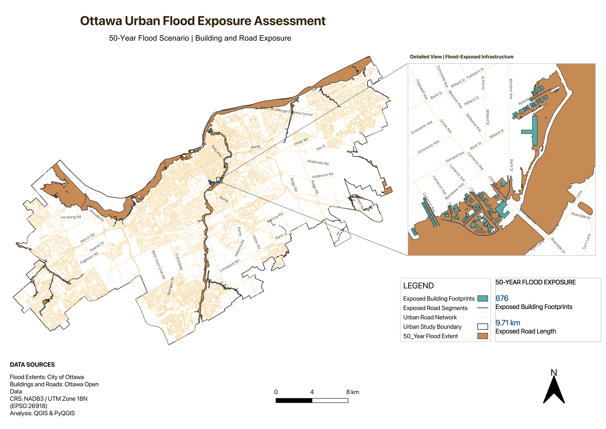
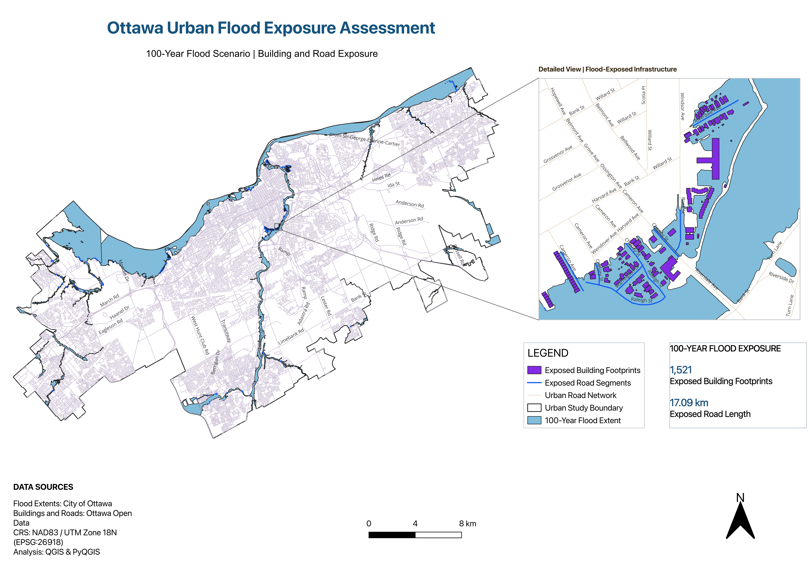
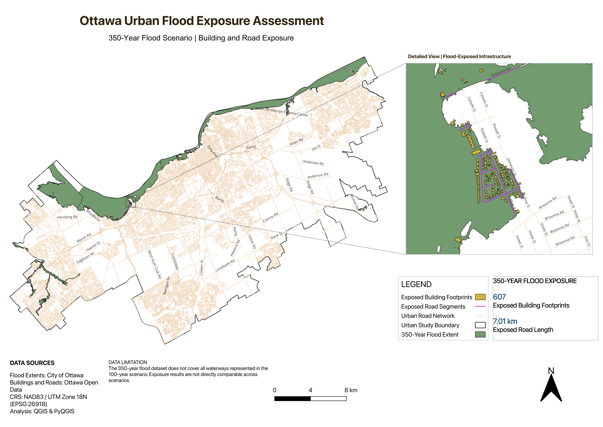

# Ottawa-Flood-Exposure-Assessment
GIS-based assessment of urban building and road exposure to flood hazards in Ottawa using QGIS and Python.
# Ottawa Urban Flood Exposure Assessment

## Project Overview
This independent GIS portfolio project assesses urban building and road exposure to mapped flood hazards in Ottawa, Ontario, Canada.

The analysis examines three flood scenarios: 50-year, 100-year, and 350-year events.

## Objectives
- Identify building footprints intersecting flood extents.
- Calculate the length of road segments within flood extents.
- Compare infrastructure exposure across flood scenarios.
- Produce professional cartographic outputs.

## Tools and Technologies
- QGIS
- Python (PyQGIS)
- GeoPackage
- Spatial analysis and geoprocessing
- NAD83 / UTM Zone 18N (EPSG:26918)

## Methodology
1. Collect and prepare spatial datasets.
2. Validate and repair flood polygon geometries.
3. Clip flood extents to Ottawa's urban study boundary.
4. Identify exposed building footprints using spatial intersection.
5. Clip road segments to flood polygons and calculate their lengths.
6. Create maps to communicate the results.

## Results

| Flood Scenario | Exposed Building Footprints | Exposed Road Length |
|---|---:|---:|
| 50-Year | 876 | 9.71 km |
| 100-Year | 1,521 | 17.09 km |
| 350-Year | 607 | 7.01 km |

## Flood Exposure Maps

### 50-Year Flood Scenario

### 100-Year Flood Scenario

### 350-Year Flood Scenario

**Data limitation:** The 350-year flood dataset does not cover all waterways represented in the 100-year scenario. Exposure results are not directly comparable across scenarios.

## Important Notes
The results represent spatial exposure to mapped flood hazards, not confirmed infrastructure damage.

Flood scenario datasets may differ in geographic coverage. The 350-year scenario has known source-coverage limitations, so comparisons require caution.

## Project Status
The GIS analysis and final maps for the 50-year, 100-year, and 350-year flood scenarios have been completed. The project is now in the portfolio documentation and GitHub publication stage, including organizing Python/PyQGIS scripts and documenting data limitations.

## Author
Mahsa Baghi
GIS & Remote Sensing Specialist
